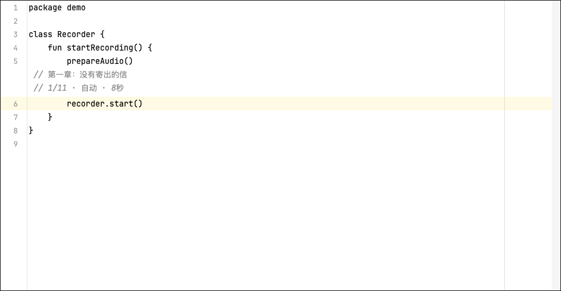

# Novel Inlay 0.8.1

An Android Studio plugin for reading TXT novels beside the caret without modifying source code. Includes a local bookshelf, chapter navigation, manual or timed paging, and persistent reading progress.

在 Android Studio 光标上方，以注释样式阅读本地 TXT 小说。文字由编辑器 Block Inlay 绘制，不进入 Document、源文件、剪贴板代码或 Git diff。

## 安装和使用

1. Android Studio → **Settings / Preferences → Plugins → 齿轮 → Install Plugin from Disk…**。
2. 选择 `dist/novel-inlay-0.8.1.zip`，按 IDE 提示重启。
3. 打开项目和代码文件，在 **Tools → Novel Inlay → 导入 TXT 小说…** 选择小说。可先用附带的 `sample.txt`。
4. 点击代码，小说就会出现在主光标上方；默认每 8 秒自动前进一页。
5. **Tools → Novel Inlay → 设置翻段间隔…** 可输入 **1–3600 秒**的整数。修改后重新计时，不会把手动模式切回自动。
6. **Tools → Novel Inlay → 切换为手动翻段（点击小说）** 会停止自动翻段。此时**左键单击小说显示区域**即可显示下一页。想恢复轮播，选择 **开启自动翻段**。
7. **Tools → Novel Inlay → 选择章节…** 打开章节目录，输入章节号或标题可筛选，点击或按回车跳转；列表默认选中当前章节。右键小说文字也能选择章节。
8. **Tools → Novel Inlay → 设置显示行数…** 可设置一次显示 **1–10 行正文**（默认 1 行），另外显示一行进度提示。设置立即生效；书尾剩余不足时只显示剩余行。
9. **Tools → Novel Inlay → 关闭小说显示** 立即隐藏小说并停止计时。之后选择 **开启小说显示** 从原位置继续；关闭状态会记忆，重启不会自动弹出小说。主动导入 TXT 会重新开启显示。
10. 右键小说文字也能打开这些菜单，并可选择上一页 / 下一页。自动模式下左键点击也会立即翻到下一页，并重新计时。可在 IDE 的 Keymap 中搜索 `NovelInlay`，自行绑定快捷键。

手动模式保留当前文字，便于慢读；一次点击前进一页（当前设置的正文行数），不向代码插入换行。读到最后一段自动停止，不从头循环。没有增加字体设置。

从 0.1.0–0.8.0 升级时，在 **Install Plugin from Disk…** 中直接选择 0.8.1 安装包并重启 IDE；插件 ID 与数据位置不变，原有小说及进度保留。原来的“暂停”状态对应手动模式；已有间隔设置保留，未设置时默认 8 秒。模式与间隔会保存，重新导入小说也保持当前选择。

## 我的书架

选择 **Tools → Novel Inlay → 我的书架…** 查看已导入和下载的本地小说。当前正在阅读的书排在最前面，列表显示书名和上次阅读段落；输入书名可筛选，单击或按回车打开。

每本书分别记忆段落和段内位置，来回切换不必从头翻。切换会重新开启小说显示，自动 / 手动模式、行数和间隔保持原设置。相同内容重复导入只保留一份缓存；不同内容保留为不同书籍。书架从插件缓存读取，原始 TXT 移动或删除后仍能切换，全程无需联网。未导入插件的电脑文件仍需先通过“导入 TXT 小说…”加入。

升级后会自动发现旧缓存。旧版只保存最后阅读书籍的书名，其他旧缓存使用“旧缓存 + 编号 + 正文开头”帮助辨认；打开后继续原有进度。从此版本开始保存所有成功导入书籍的名字。已丢失的缓存不列出，损坏的缓存打开时会报错并保留当前书及进度。

本版书架提供列表、筛选和切换，暂不提供删除或重命名。

## 搜索并下载小说

1. 选择 **Tools → Novel Inlay → 搜索并下载小说…**。
2. 在同一个窗口填写 **书名**和可选的**作者完整笔名**，至少填写一项，每项最多 30 字。也可以留空书名，仅按作者搜索。
3. 结果列表显示 **书名 · 作者**。书名按关键词匹配，完整书名匹配排在前面；填写作者时按全名匹配，避免“耳根”混入“折耳根”。比较时忽略空白、大小写和全半角差异。可输入文字继续筛选，单击或按回车选择一本，开始后台下载。
4. 下载成功后自动打开小说，复用章节选择、显示行数和阅读进度。无需自己找链接；原来的链接导入菜单已替换成搜索入口。

搜索或下载可在 IDE 后台任务中取消；失败或取消不会替换当前小说或进度。无结果时会提示调整关键词。每次只发起一次搜索：有书名时查询书名，再用作者全名筛选；书名为空时查询作者。网站一次只返回部分匹配（实测最多 50 项），筛选不会扩大网站返回范围；找不到时可使用完整书名，或留空书名改按作者搜索。网站限制两次搜索至少间隔 30 秒，遇到限制会明确提示，不会当成“没有结果”。下载期间暂不能开始另一项搜索。

文件缓存到本地后可以离线阅读，重启也不需要重新下载。下载大小限制仍为 20 MiB，重新下载相同内容会恢复原有位置。

搜索使用网站的 GBK 表单编码，不支持表情等无法编码的字符。每次请求使用临时会话 Cookie，处理网站首次 403 设置 Cookie 后要求重试的响应，不读取浏览器 Cookie，也不保存登录信息。只使用该站的搜索结果和同源下载跳转；出现验证码或其他错误时，可用浏览器下载后导入本地 TXT。单次连接及读取等待上限各 10 秒，下载检查总时限约 60 秒；取消可能需要等待当前网络操作结束。

已用插件的网络代码实测“搜索《西游记》→ 选择吴承恩原著 → 下载 TXT → 解析 100 回”，未展示或打包小说正文。0.7.0 已实测“我欲封天 + 耳根”仅返回作者为耳根的对应书籍（只查询元数据）。搜索、下载异常和取消使用原创样本服务测试；网站规则变化可能导致搜索或下载失败。

## 章节识别

导入时识别独占一行、不超过 80 字符的常见标题：`第一章`、`第 123 章 标题`、`第１２３章`、`正文 第一章`、`Chapter 1`，以及序章、楔子、尾声、后记等。中文编号支持章 / 节 / 回 / 卷 / 部 / 篇。章节只建立索引，不改写 TXT 或原有分段，因此旧版阅读进度仍有效。

没有识别到章节时会提示原因，正常阅读和进度保存不受影响。自定义标题格式可能漏识别，正文里的短行或文件自带目录可能被识别为章节；同名章节按原文件顺序分别列出。

## 显示与阅读进度

- 内容跟随主光标，最多约 250 毫秒更新；在多个编辑器之间切换时只保留一处显示。
- 使用 IDE 注释颜色和编辑器字号，中文缺字时使用系统逻辑字体回退。保留原来的 48 个 Unicode 码点分段作为进度索引，再按编辑器可见宽度换行；一页最多显示设定的正文行数，翻页连续读取，不截掉剩余文字。
- 只有 IDE 在前台、代码编辑器有焦点、整段文字可见时才累计自动翻段时间。打开菜单、切到终端、切出 IDE 或把文字滚出视野时停止计时。
- 每本书按内容 SHA-256 保存进度；重新导入相同内容可续读。书名改变不影响识别，内容改变则作为另一本书。
- 保存当前段落和段内字符位置，重启后从这一页开头继续。调整行数或窗口宽度不会重置位置。进度使用 IDE 的本地设置持久化机制，在 IDE 保存设置及正常退出时落盘；强制结束进程可能回退到最近一次保存。
- 导入会保存一份本地缓存，原 TXT 移动或删除后仍可续读；仅主动搜索或下载时联网，本地导入与阅读无需联网。小说与进度不写进项目目录。

支持 UTF-8（含 BOM）、带 BOM 的 UTF-16 LE/BE，以及 UTF-8 解码失败后的 GB18030 / GBK 回退。原文件与转换后的 UTF-8 均限 20 MiB。无 BOM 编码识别存在歧义，遇到乱码请另存为 UTF-8 再导入。

在当前 macOS Android Studio 2024.3.2 中，本地数据位于 IDE 配置目录：

```text
~/Library/Application Support/Google/AndroidStudio2024.3.2/options/novel-inlay.xml
~/Library/Application Support/Google/AndroidStudio2024.3.2/novel-inlay/books/
```

小说缓存按书保留。卸载插件不会自动删除阅读数据；需要彻底清除时，退出 IDE 后删除上述插件专属文件 / 目录。没有启用 Settings Sync 同步。

## 兼容范围

本包针对本机 **Android Studio 2024.3.2，AI-243.26053.27.2432.13536105，JBR 21** 构建。插件描述符限定平台 **243.***；没有声称兼容其他平台分支。实现仅依赖 IntelliJ Platform，但其他 IDE 尚未验证。

## 构建和测试

没有新增运行时依赖，直接使用已安装 Android Studio 的 JDK 和 SDK JAR；不需要 Gradle 或联网下载。

```bash
bash build.sh
python3 smoke-test.py
# 可选：打开独立测试窗口，约半分钟检查真实计时、焦点与绘制。
python3 smoke-test.py --gui
```

默认 IDE 目录为 `/Applications/Android Studio.app/Contents`。自定义安装位置可通过 `ANDROID_STUDIO_HOME` 指定；构建和测试脚本目前在 macOS 上验证。

`build.sh` 编译插件并运行文本核心和本地 HTTP 服务测试，覆盖书架扫描、重复导入、旧缓存名称恢复、缓存完整性、两本书之间的精确位置切换及重启后的书名保存，以及书名与作者联合筛选、作者全名匹配、完整书名排序、单项搜索、限频提示、GBK 搜索表单、结果书名与作者、HTML 实体、去重、无结果 / 异常页面、链接校验、会话重试、跳转边界、下载内容解析、HTML / 超限 / HTTP 错误拒绝和取消。`smoke-test.py` 将测试入口仅加入隔离测试包，使用 `build/smoke/` 下独立的 config、system、plugins、log，不安装到日常 IDE，也不打开用户项目。交付 ZIP 不包含测试入口。

核心测试覆盖 1/2/5/10 行分页、宽窄窗口、连续翻页不丢字、Unicode 边界、上一页定位、章节识别、章节偏移、无章节与同名标题，以及计时资格、暂停 / 恢复、休眠不跳段、编码、空文件 / 非文本 / 超限拒绝、Unicode 分段不丢字、边界进度、缓存读回以及源 TXT 不变。IDE 测试覆盖加载、菜单注册、真实 Block Inlay、光标位置变化、Document 文本和修改标记不变、释放清理、章节跳转、无效选择保护、立即关闭与重新开启、行数改变与高度变化、设置序列化与两个进程间章节内进度的恢复。

可选 GUI 测试会把独立窗口带到前台，期间请勿使用键鼠或切换窗口。它检查实际计时、暂停、焦点离开和中文绘制；共享桌面的焦点变化可能使它失败。开发时已观察到中文绘制、光标跟随、自动翻段和暂停成功，但整套 GUI 自动化未稳定通过；不代表已经完成完整项目中的人工交互验收。



截图来自隔离测试窗口，使用 Android Studio 自带编辑器组件；不是完整项目窗口截图。

## 实现依据

- [JetBrains：EditorCustomElementRenderer（243 源码）](https://raw.githubusercontent.com/JetBrains/intellij-community/idea/243.26053.27/platform/editor-ui-api/src/com/intellij/openapi/editor/EditorCustomElementRenderer.java)
- [JetBrains：Persisting State of Components](https://plugins.jetbrains.com/docs/intellij/persisting-state-of-components.html)
- [JetBrains：Plugin Compatibility](https://plugins.jetbrains.com/docs/intellij/plugin-compatibility.html)

## 开源许可

本项目采用 [Apache License 2.0](LICENSE)。源码仓库：[datouggg/missNovel](https://github.com/datouggg/missNovel)。

许可证适用于本项目代码及随附的原创示例，不授予第三方小说内容的使用权。在线搜索和下载依赖第三方网站，其可用性与内容授权需由使用者另行确认。
